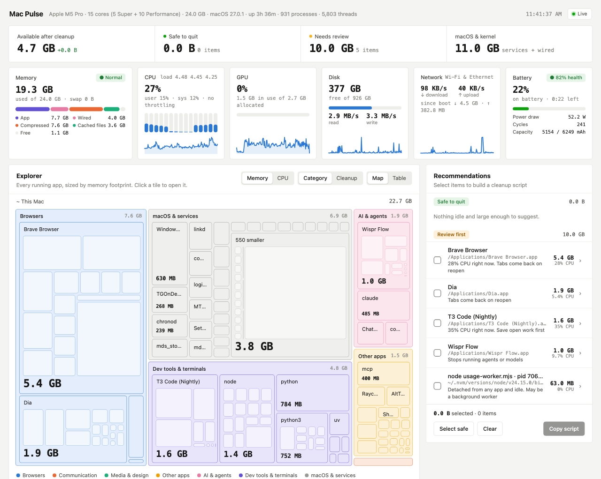

# Mac Pulse

A live map of what is using your Mac's memory and CPU, with a cleanup list that turns into a script you can paste into Terminal.



## What it shows

- Every running app and process as a treemap, grouped by category (browsers, dev tools, AI apps, communication, media, other apps, macOS). Size the tiles by memory or by current CPU. Click a tile to drill from category to app to single processes, or switch to a table.
- Memory used, split into app, wired, compressed, cached and free, plus swap and the macOS memory pressure level.
- CPU load per core, user and system time, load average and thermal throttling.
- GPU utilization and GPU memory.
- Disk free space and read/write speed.
- Network download and upload speed.
- Battery charge, health, cycle count, capacity and power draw in watts.

## Cleanup suggestions

The right-hand list sorts apps and processes into two groups:

- **Safe to quit**: communication, media and other apps that use at least 200 MB and are idle (under 3% CPU). These start out ticked.
- **Review first**: any other app over 400 MB or 30% CPU (browsers, editors and AI apps always land here), single processes over 1 GB or 50% CPU, and idle node or Python workers over 50 MB with no parent app. Detached workers are often background services on purpose, so they never go in the safe group.

macOS processes are never suggested, and neither is the app that launched Mac Pulse.

**Copy script** builds a zsh script from what you ticked. Apps get a normal quit through `osascript`, the same as choosing Quit from the menu. Single processes get `kill`, guarded by a check that the process ID still belongs to the same program, so a reused ID can't take down something else. Nothing runs until you paste the script yourself.

## Run it

It needs only the Python 3 that ships with macOS. There are no dependencies to install.

```sh
python3 macpulse.py                       # live view at http://127.0.0.1:8765, refreshes every 2.5 s
python3 macpulse.py --snapshot out.html   # one self-contained HTML file of the current state
python3 macpulse.py --port 9000 --interval 5 --no-open
```

The server listens on 127.0.0.1 only. A snapshot file embeds your process list, hostname and app paths, so check it before you share one.

## How it reads the numbers

| Metric | Source |
| --- | --- |
| Per-process memory | `top` memory footprint, the figure Activity Monitor shows |
| Per-process CPU | change in `ps` CPU time between samples (100% = one core) |
| Per-core CPU | `host_processor_info` through `ctypes` |
| Memory breakdown | `vm_stat`, `sysctl vm.swapusage`, `kern.memorystatus_vm_pressure_level` |
| GPU | `ioreg` IOAccelerator performance statistics |
| Disk and network | `ioreg` block storage counters, `netstat -ib` on `en*` interfaces |
| Battery | `ioreg` AppleSmartBattery |

Shared memory counts once for every process that maps it, so an app's total can read a little higher than its real share.

## License

MIT
